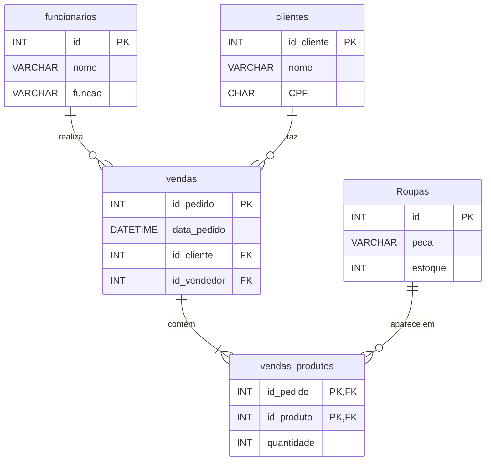

# Mais Moda Store: Banco de Dados Relacional

Banco de dados relacional em **MySQL** para gerenciar uma loja de roupas: equipe, estoque, clientes e vendas.

## 🗂️ Estrutura do banco

| Tabela | Função |
|---|---|
| `funcionarios` | Cadastro da equipe (nome e função) |
| `Roupas` | Cadastro das peças e da quantidade em estoque |
| `clientes` | Cadastro de clientes |
| `vendas` | Pedidos: data, cliente e vendedor responsável |
| `vendas_produtos` | Itens de cada pedido |

## 🔑 Conceitos aplicados

- **Chave primária** com `AUTO_INCREMENT`
- **Chaves estrangeiras** (`FOREIGN KEY`) ligando vendas a clientes e funcionários
- **Relacionamento N:N** entre vendas e roupas, resolvido com a tabela `vendas_produtos` e **chave primária composta** (`id_pedido`, `id_produto`)
- Alteração de estrutura com `ALTER TABLE` (inclusão da coluna `quantidade`)

## ▶️ Como executar

1. Abra o **MySQL Workbench** (ou outro cliente MySQL)
2. Abra o arquivo [`mais-moda-store.sql`](mais-moda-store.sql)
3. Execute o script inteiro. Ele cria o banco `mais_moda_store`, as tabelas e os dados de exemplo.

> Os nomes e CPFs são fictícios, usados só para teste.
